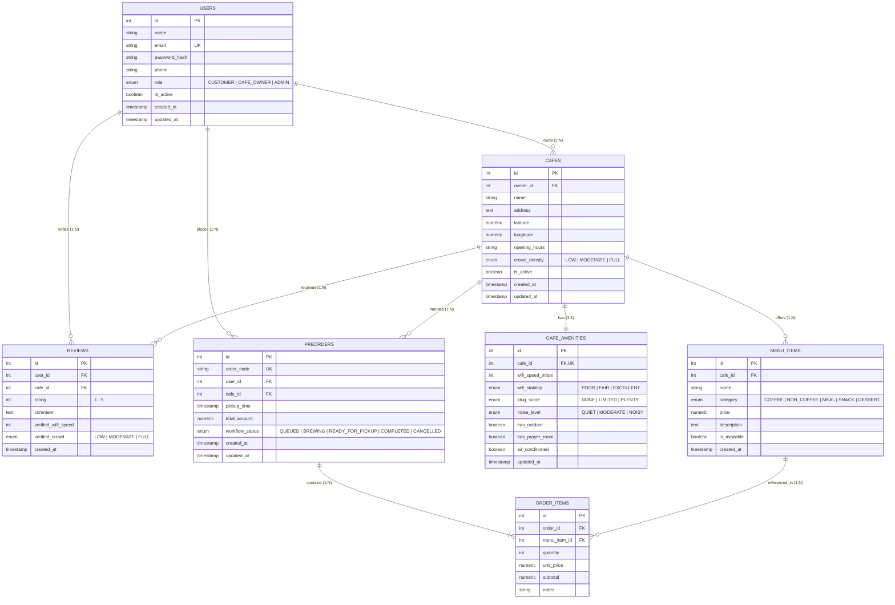

# CafePulse REST API ☕📊

[](https://www.python.org/)
[](https://flask.palletsprojects.com/)
[](https://www.sqlalchemy.org/)
[](https://supabase.com/)
[](https://vercel.com/)

RESTful API modular untuk direktori kafe ramah kerja (*work-friendly cafes* & *coworking spaces*) yang dilengkapi dengan metrik kenyamanan kerja (kecepatan Wi-Fi, ketersediaan colokan, tingkat kebisingan), ulasan komunitas, serta fitur pemesanan awal (*pre-order*). Proyek ini dibangun sebagai tugas akhir program **Learning Labs: Backend Development**.

---

## 📌 Daftar Isi
- [1. Ringkasan & Arsitektur Proyek](#1-ringkasan--arsitektur-proyek)
- [2. Tech Stack & Environment](#2-tech-stack--environment)
- [3. Entity Relationship Diagram (ERD)](#3-entity-relationship-diagram-erd)
- [4. Spesifikasi Endpoint API](#4-spesifikasi-endpoint-api)
- [5. Panduan Instalasi & Menjalankan Lokal](#5-panduan-instalasi--menjalankan-lokal)
- [6. Konfigurasi Deployment Vercel](#6-konfigurasi-deployment-vercel)
- [7. Panduan Pengujian API (Postman / Thunder Client)](#7-panduan-pengujian-api-postman--thunder-client)

---

## 1. Ringkasan & Arsitektur Proyek

CafePulse API mengadopsi standar arsitektur modular dengan pola **Application Factory Pattern** pada Flask:
- `app/` mengisolasi inisialisasi aplikasi, extensions database, definisi model ORM, dan rute (Blueprints).
- Model ORM SQLAlchemy secara eksplisit terhubung ke skema custom `cafepulse` pada Supabase PostgreSQL.
- Database connection pooling dioptimalkan untuk arsitektur serverless di Vercel via Supabase Transaction Pooler (Port 6543) dengan `pool_pre_ping` dan `pool_recycle`.

### Struktur Direktori
```text
cafepulse_api/
├── app/
│   ├── models/
│   │   ├── __init__.py      # Re-export seluruh model ORM
│   │   └── cafe.py          # Definisi 7 Model ORM (Schema: cafepulse)
│   ├── routes/
│   │   ├── cafes.py         # Blueprint CRUD resource kafe (/api/cafes)
│   │   └── main.py          # Blueprint Health check & DB check
│   ├── __init__.py          # create_app() & error handlers
│   └── extensions.py        # Inisialisasi db = SQLAlchemy()
├── .env.example             # Template konfigurasi environment
├── .gitignore
├── requirements.txt         # Daftar pustaka & dependensi
├── run.py                   # WSGI entrypoint server
├── vercel.json              # Konfigurasi deployment Vercel Serverless
└── README.md                # Dokumentasi teknis proyek
```

---

## 2. Tech Stack & Environment

- **Language:** Python 3.12
- **Framework:** Flask 3.1.x
- **ORM:** Flask-SQLAlchemy 3.1.x / SQLAlchemy 2.x
- **Database Driver:** `psycopg2-binary`
- **Database Cloud:** PostgreSQL 15+ Hosted on Supabase Cloud (Region: `ap-southeast-1` / Singapore)
- **Database Schema:** `cafepulse` (Custom schema terisolasi)
- **Serverless Hosting:** Vercel Functions (`@vercel/python`)

---

## 3. Entity Relationship Diagram (ERD)

Database terdiri dari **7 tabel relasional** dengan relasi **1:1**, **1:N**, dan **N:N** (via junction table `order_items`):



---

## 4. Spesifikasi Endpoint API

Semua respons API disajikan dalam format JSON dengan format status standar:
- Operasi Berhasil: `"status": "success"`
- Operasi Gagal: `"status": "error"`

### Daftar Ringkasan Endpoint

| Method | Endpoint | Deskripsi | Status Code Sukses | Status Code Error |
| :--- | :--- | :--- | :--- | :--- |
| **GET** | `/` | Service health check & API metadata | `200 OK` | `500 Internal Error` |
| **GET** | `/db-check` | Verifikasi koneksi live ke Supabase | `200 OK` | `500 Internal Error` |
| **GET** | `/api/cafes` | Ambil semua data kafe + fasilitas amenities | `200 OK` | `500 Internal Error` |
| **GET** | `/api/cafes/<id>` | Ambil detail 1 kafe + amenities + ulasan | `200 OK` | `404 Not Found`, `500` |
| **POST** | `/api/cafes` | Tambah data kafe baru (+ amenities opsional) | `201 Created` | `400 Bad Request`, `500` |
| **PUT** | `/api/cafes/<id>` | Perbarui data kafe & fasilitas amenities | `200 OK` | `400 Bad Request`, `404`, `500` |
| **DELETE** | `/api/cafes/<id>` | Hapus data kafe (cascade delete) | `200 OK` | `404 Not Found`, `500` |

---

### Detail Spesifikasi Request & Response

#### 1. Service Health Check
- **Endpoint:** `GET /`
- **Headers:** `Accept: application/json`
- **Response `200 OK`:**
```json
{
  "status": "success",
  "name": "CafePulse REST API",
  "version": "1.0.0",
  "description": "Modular REST API for Cafe & Coworking Space Management with PostgreSQL Supabase",
  "endpoints": {
    "health_check": "GET /",
    "db_check": "GET /db-check",
    "list_cafes": "GET /api/cafes",
    "cafe_detail": "GET /api/cafes/<int:cafe_id>",
    "create_cafe": "POST /api/cafes",
    "update_cafe": "PUT /api/cafes/<int:cafe_id>",
    "delete_cafe": "DELETE /api/cafes/<int:cafe_id>"
  }
}
```

---

#### 2. Supabase Database Check
- **Endpoint:** `GET /db-check`
- **Deskripsi:** Menjalankan `SELECT 1` langsung ke PostgreSQL Supabase untuk memvalidasi kredensial dan search path schema `cafepulse`.
- **Response `200 OK`:**
```json
{
  "status": "success",
  "database": "Terhubung ke Supabase PostgreSQL!",
  "schema": "cafepulse",
  "stats": {
    "active_cafes": 2
  }
}
```
- **Response `500 Internal Server Error`:**
```json
{
  "status": "error",
  "message": "Koneksi database gagal: (psycopg2.OperationalError) ..."
}
```

---

#### 3. List All Cafes (Read All)
- **Endpoint:** `GET /api/cafes`
- **Query Parameters (Opsional):**
  - `q`: Pencarian nama kafe (misal: `?q=Ruang`)
  - `crowd_density`: Filter kepadatan (`LOW`, `MODERATE`, `FULL`)
- **Response `200 OK`:**
```json
{
  "status": "success",
  "total": 2,
  "data": [
    {
      "id": 1,
      "owner_id": 1,
      "name": "Ruang Temu Coffee & Space",
      "address": "Jl. Slamet Riyadi No. 120, Surakarta",
      "latitude": -7.569421,
      "longitude": 110.825123,
      "opening_hours": "08:00 - 23:00",
      "crowd_density": "LOW",
      "is_active": true,
      "created_at": "2026-10-04T08:57:37.775802+00:00",
      "updated_at": "2026-10-04T08:57:37.775802+00:00",
      "amenities": {
        "id": 1,
        "cafe_id": 1,
        "wifi_speed_mbps": 85,
        "wifi_stability": "EXCELLENT",
        "plug_score": "PLENTY",
        "noise_level": "QUIET",
        "has_outdoor": true,
        "has_prayer_room": true,
        "air_conditioned": true,
        "updated_at": "2026-10-04T08:57:37.775802+00:00"
      },
      "total_reviews": 1
    }
  ]
}
```

---

#### 4. Detail Single Cafe (Read One)
- **Endpoint:** `GET /api/cafes/<int:cafe_id>`
- **Response `200 OK`:**
```json
{
  "status": "success",
  "data": {
    "id": 1,
    "owner_id": 1,
    "name": "Ruang Temu Coffee & Space",
    "address": "Jl. Slamet Riyadi No. 120, Surakarta",
    "latitude": -7.569421,
    "longitude": 110.825123,
    "opening_hours": "08:00 - 23:00",
    "crowd_density": "LOW",
    "is_active": true,
    "created_at": "2026-10-04T08:57:37.775802+00:00",
    "updated_at": "2026-10-04T08:57:37.775802+00:00",
    "amenities": {
      "id": 1,
      "cafe_id": 1,
      "wifi_speed_mbps": 85,
      "wifi_stability": "EXCELLENT",
      "plug_score": "PLENTY",
      "noise_level": "QUIET",
      "has_outdoor": true,
      "has_prayer_room": true,
      "air_conditioned": true,
      "updated_at": "2026-10-04T08:57:37.775802+00:00"
    },
    "total_reviews": 1,
    "reviews": [
      {
        "id": 1,
        "user_id": 2,
        "cafe_id": 1,
        "rating": 5,
        "comment": "Koneksi stabil buat remote work, colokan banyak.",
        "verified_wifi_speed": 88,
        "verified_crowd": "LOW",
        "created_at": "2026-10-04T08:57:37.775802+00:00"
      }
    ]
  }
}
```
- **Response `404 Not Found`:**
```json
{
  "status": "error",
  "message": "Kafe dengan ID 999 tidak ditemukan"
}
```

---

#### 5. Tambah Data Kafe (Create)
- **Endpoint:** `POST /api/cafes`
- **Headers:** `Content-Type: application/json`
- **Request Body:**
```json
{
  "name": "Kopi Senja Solo",
  "address": "Jl. Gatot Subroto No. 88, Surakarta",
  "latitude": -7.568120,
  "longitude": 110.822340,
  "opening_hours": "07:00 - 23:00",
  "crowd_density": "LOW",
  "amenities": {
    "wifi_speed_mbps": 100,
    "wifi_stability": "EXCELLENT",
    "plug_score": "PLENTY",
    "noise_level": "QUIET",
    "has_outdoor": true,
    "has_prayer_room": true,
    "air_conditioned": true
  }
}
```
- **Response `201 Created`:**
```json
{
  "status": "success",
  "message": "Data kafe berhasil ditambahkan",
  "data": {
    "id": 3,
    "owner_id": 1,
    "name": "Kopi Senja Solo",
    "address": "Jl. Gatot Subroto No. 88, Surakarta",
    "latitude": -7.56812,
    "longitude": 110.82234,
    "opening_hours": "07:00 - 23:00",
    "crowd_density": "LOW",
    "is_active": true,
    "created_at": "2026-10-24T05:03:05.186815+00:00",
    "updated_at": "2026-10-24T05:03:05.186815+00:00",
    "amenities": {
      "id": 3,
      "cafe_id": 3,
      "wifi_speed_mbps": 100,
      "wifi_stability": "EXCELLENT",
      "plug_score": "PLENTY",
      "noise_level": "QUIET",
      "has_outdoor": true,
      "has_prayer_room": true,
      "air_conditioned": true,
      "updated_at": "2026-10-24T05:03:05.407080+00:00"
    },
    "total_reviews": 0
  }
}
```
- **Response `400 Bad Request`:**
```json
{
  "status": "error",
  "message": "Field 'name' dan 'address' wajib diisi"
}
```

---

#### 6. Perbarui Data Kafe (Update)
- **Endpoint:** `PUT /api/cafes/<int:cafe_id>`
- **Headers:** `Content-Type: application/json`
- **Request Body:**
```json
{
  "name": "Kopi Senja Solo (Renovated)",
  "crowd_density": "MODERATE",
  "amenities": {
    "wifi_speed_mbps": 150,
    "noise_level": "MODERATE"
  }
}
```
- **Response `200 OK`:**
```json
{
  "status": "success",
  "message": "Data kafe dengan ID 3 berhasil diperbarui",
  "data": {
    "id": 3,
    "name": "Kopi Senja Solo (Renovated)",
    "crowd_density": "MODERATE",
    "amenities": {
      "wifi_speed_mbps": 150,
      "noise_level": "MODERATE"
    }
  }
}
```
- **Response `404 Not Found`:**
```json
{
  "status": "error",
  "message": "Kafe dengan ID 3 tidak ditemukan"
}
```

---

#### 7. Hapus Data Kafe (Delete)
- **Endpoint:** `DELETE /api/cafes/<int:cafe_id>`
- **Response `200 OK`:**
```json
{
  "status": "success",
  "message": "Kafe 'Kopi Senja Solo (Renovated)' (ID: 3) berhasil dihapus"
}
```
- **Response `404 Not Found`:**
```json
{
  "status": "error",
  "message": "Kafe dengan ID 3 tidak ditemukan"
}
```

---

## 5. Panduan Instalasi & Menjalankan Lokal

### Prasyarat
- Python 3.10+ terinstal di sistem Anda.
- Akun dan project aktif di [Supabase](https://supabase.com/).

### Langkah Instalasi

1. **Clone Repositori & Masuk ke Direktori Proyek:**
   ```bash
   git clone <URL_REPOSITORY_ANDA>
   cd cafepulse_api
   ```

2. **Buat & Aktifkan Virtual Environment:**
   - **Windows:**
     ```powershell
     python -m venv venv
     .\venv\Scripts\activate
     ```
   - **Linux / macOS:**
     ```bash
     python3 -m venv venv
     source venv/bin/activate
     ```

3. **Instal Dependensi:**
   ```bash
   pip install -r requirements.txt
   ```

4. **Konfigurasi Environment Variables:**
   Salin berkas `.env.example` menjadi `.env`:
   ```bash
   cp .env.example .env
   ```
   Buka file `.env` dan masukkan connection string Supabase Anda:
   ```env
   FLASK_DEBUG=True
   PORT=5000
   DATABASE_URL=postgresql+psycopg2://postgres.<project_ref>:<password>@aws-0-ap-south-1.pooler.supabase.com:6543/postgres?options=-csearch_path%3Dcafepulse,public
   ```
   > [!IMPORTANT]
   > - Gunakan port **`6543`** (**Transaction Pooler**) untuk efisiensi koneksi serverless.
   > - Pastikan parameter `?options=-csearch_path%3Dcafepulse,public` disertakan agar PostgreSQL mengenali tabel pada skema `cafepulse`.

5. **Jalankan Aplikasi:**
   ```bash
   python run.py
   ```
   Aplikasi akan aktif di `http://127.0.0.1:5000`.

---

## 6. Konfigurasi Deployment Vercel

Proyek ini telah dikonfigurasi untuk deployment ke platform **Vercel** menggunakan `@vercel/python`.

### Berkas `vercel.json`
```json
{
  "version": 2,
  "builds": [
    {
      "src": "run.py",
      "use": "@vercel/python"
    }
  ],
  "routes": [
    {
      "src": "/(.*)",
      "dest": "run.py"
    }
  ]
}
```

### Langkah Deploy ke Vercel

1. **Push kode ke GitHub/GitLab.**
2. Buka dashboard [Vercel](https://vercel.com/) dan pilih **Add New Project**.
3. Import repositori GitHub Anda.
4. Pada menu **Environment Variables**, tambahkan:
   - `DATABASE_URL`: `postgresql+psycopg2://<user>:<password>@<pooler_host>:6543/postgres?options=-csearch_path%3Dcafepulse,public`
   - `FLASK_DEBUG`: `False`
5. Klik **Deploy**.
6. Setelah deployment berhasil, uji endpoint health check pada domain Vercel Anda:
   `https://<nama-project-anda>.vercel.app/` dan `https://<nama-project-anda>.vercel.app/db-check`

---

## 7. Panduan Pengujian API (Postman / Thunder Client)

### Pengujian dengan Thunder Client (VS Code)
1. Buka ekstensi **Thunder Client** di VS Code.
2. Buat Collection baru bernama `CafePulse API`.
3. Buat Environment Variable:
   - `base_url`: `http://127.0.0.1:5000` (atau URL Vercel saat live)
4. Buat Request sesuai daftar berikut:
   - `GET {{base_url}}/`
   - `GET {{base_url}}/db-check`
   - `GET {{base_url}}/api/cafes`
   - `GET {{base_url}}/api/cafes/1`
   - `POST {{base_url}}/api/cafes` (Header: `Content-Type: application/json`, masukkan body json kafe baru)
   - `PUT {{base_url}}/api/cafes/1` (Header: `Content-Type: application/json`)
   - `DELETE {{base_url}}/api/cafes/1`

### Checklist Pengujian Kriteria Kelulusan
- [x] Database 7 tabel relasional terhubung (1:1, 1:N, N:N via `cafepulse` schema).
- [x] Full CRUD teruji (GET, POST, PUT, DELETE).
- [x] Status code HTTP tepat (200 OK, 201 Created, 400 Bad Request, 404 Not Found, 500 Error).
- [x] Output response konsisten JSON.
- [x] Siap deploy serverless di Vercel (`vercel.json` dan WSGI handler di `run.py`).
- [x] Dokumentasi teknis lengkap dan rapi di `README.md`.

